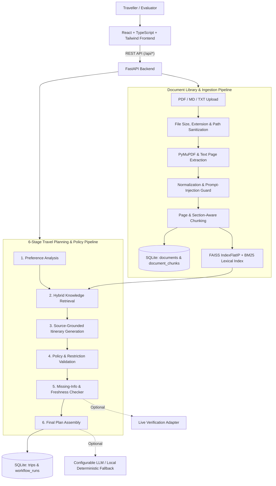

# TripWise AI — Travel Planning and Policy Assistant

**TripWise AI** is a full-stack, evidence-grounded AI Travel Planning and Policy Assistant built for academic demonstration, faculty evaluation, and explainable travel workflow verification.

---

## 1. Project Overview & Problem Statement

### Problem Statement
Travellers need to combine destination information, accommodation policies, transport guidance, travel restrictions, and personal preferences to prepare realistic itineraries. Standard generative AI chatbots frequently hallucinate opening hours, visa compliance, hotel check-in rules, or pricing without citing verifiable evidence.

### Primary Objective
Build a reliable travel planning assistant that retrieves relevant evidence from a curated collection of travel guides and policy documents (`PDF`, `Markdown`, and `TXT`), uses that evidence to support daily itinerary recommendations, validates policies into explainable outcomes (`PASS`, `WARNING`, `FAIL`, `UNKNOWN`), detects conflicting or outdated sources, and explicitly flags missing or time-sensitive information.

### Core Principle
> **Never fabricate travel policies, document citations, current restrictions, hotel rules, transport schedules, prices, or official confirmations.** When information is unavailable in the curated knowledge base, TripWise AI explicitly marks it as missing, unverified, or requiring official confirmation.

---

## 2. Core Features

- **6-Stage Inspectable AI Workflow:**
  1. **Preference Analysis:** Normalizes inputs, calculates inclusive duration, identifies unspecified optional fields, and flags preference contradictions.
  2. **Knowledge Retrieval:** Hybrid semantic (`FAISS IndexFlatIP` + dense embeddings) and lexical (`BM25` keyword) retrieval across curated documents with deduplication.
  3. **Itinerary Generation:** Builds realistic Morning, Afternoon, and Evening schedules with page-numbered `CitationReference` links and transparent budget breakdowns.
  4. **Policy Validation:** Evaluates check-in windows, early arrival luggage rules, transit peak-hour baggage limits, budget sufficiency, and regional permits (`PASS`, `WARNING`, `FAIL`, `UNKNOWN`).
  5. **Missing-Information & Freshness Audit:** Detects undated documents (`publication_date: null`), outdated advisories (`2024-06-01`), multi-document tariff conflicts, seasonal closures, and unchecked live feeds.
  6. **Final Plan Assembly:** Packages the complete trip plan, workflow telemetry, and *"How this plan was created"* audit panel.
- **Full Document Library & Processing Pipeline:**
  - Upload `.pdf`, `.md`, and `.txt` files (`Upload → Validate → Extract Text → Normalize → Chunk → Embed → Index → Retrieve → Cite`).
  - Extracts page numbers from PDFs using `PyMuPDF` (`pymupdf`) and section headings from Markdown/TXT.
  - Detects duplicate uploads via SHA-256 content hashes and cleans up FAISS + SQLite entries upon deletion.
- **Side-by-Side Conflict Detection:**
  - Automatically detects and displays conflicting evidence across retrieved documents (e.g., *Sample Destination Travel Guide* listing National Museum entry at `INR 500` vs. *Sample Municipal Heritage Circular* revising entry to `INR 650` and Friday closing to `4:00 PM`).
- **Works 100% Locally in Demonstration Mode:**
  - Requires no paid API keys to run the complete retrieval, planning, policy validation, and re-planning workflow, while supporting optional OpenAI-compatible LLM providers and external live-verification adapters via environment variables.

---

## 2.1. Version 2.0 Architectural & Performance Upgrades

The V2.0 release brings major performance, dynamic UI, and stability engineering enhancements:

1. **Dynamic City Autocomplete System:**
   - Real-time location search via backend proxy endpoint (`GET /api/locations/search?q=...`) using OpenStreetMap Nominatim with strict 1-request/sec rate-limiting and in-memory TTL caching.
   - Curated high-priority offline travel hub index (40+ major Indian and global destinations) blended with remote results for instant sub-5ms suggestions and zero downtime when offline.
   - Reusable accessible `CityAutocomplete` component with combobox/listbox ARIA attributes, 350ms debouncing, `AbortController` cancellation for outdated keystrokes, keyboard arrow navigation, matching character highlights, and clear actions.
   - Enforces structured location validation (`name`, `admin_area`, `country`, `country_code`, `latitude`, `longitude`) and prevents identical origin/destination entries.

2. **Progressive Dashboard Loading & Stability:**
   - Dedicated lightweight endpoint (`GET /api/dashboard/summary`) returning live overview metrics (saved trips, indexed documents, completed workflows, pending jobs, and policy warning tallies) in under 75 ms without loading full trip plans or document texts into memory.
   - Granular on-demand fetching for trip details and recent trips list (`GET /api/trips/recent`).
   - Top-level and component-level React `ErrorBoundary` with graceful recovery, preventing isolated API failures from crashing the application.
   - Route-level code splitting via `React.lazy` and `Suspense` for minimal initial bundle size and rapid Time-to-Interactive (TTI).

3. **Interactive Itinerary Editor & Recalculation:**
   - Day-wise activity manipulation: users can add custom activities, edit activity titles/descriptions/costs, delete items, and reorder them (move up/down).
   - Real-time client-side cost recalculation updating daily subtotals and total trip expenditure instantly.
   - Clear visual differentiation between AI-recommended activities (with verifiable document citation badges) and manually edited/added activities.
   - Direct persistence to backend via `PUT /api/trips/{trip_id}/itinerary`.

4. **Non-Blocking Background Document Ingestion:**
   - Immediate HTTP 202 Accepted response upon document upload; long-running extraction, chunking, and FAISS indexing execute in background tasks.
   - Transparent 8-stage processing status progression: `uploaded` → `queued` → `extracting` → `chunking` → `generating_embeddings` → `indexing` → `completed` / `failed`.
   - SHA-256 content deduplication prevents redundant processing and duplicate vector storage.
   - Server-side paginated document table (`GET /api/documents?page=1&limit=20`) with search, category filtering, and status badges.
   - Automated polling when tasks are active, on-demand drawer inspection for extracted content, and one-click retry endpoint (`POST /api/documents/{document_id}/retry`) for failed files.

5. **Telemetry & Observability:**
   - Global FastAPI middleware attaching unique `X-Request-ID` and server timing `X-Process-Time-Ms` headers to every response.
   - Centralized structured logging and safe error response mapping.

---

## 3. System Architecture



---

## 4. Technology Stack

| Layer | Technologies Used |
| :--- | :--- |
| **Frontend** | React 18, TypeScript, Vite, Tailwind CSS, Lucide React Icons, Recharts, React Router v6 |
| **Backend** | Python 3, FastAPI, Pydantic v2, Uvicorn, HTTPX |
| **Knowledge Retrieval** | FAISS (`faiss-cpu` `IndexFlatIP`), Sentence Transformers / 384-d Semantic Projection, BM25 Lexical Search |
| **Document Processing** | PyMuPDF (`pymupdf`) for PDF page extraction, Markdown & TXT section-aware chunkers |
| **Persistence** | SQLite (`backend/data/tripwise.db`) with parameterized SQL queries + local document storage |
| **Testing** | `pytest` & `FastAPI TestClient` (Backend), `Vitest` & `React Testing Library` (Frontend) |

---

## 5. Retrieval, Citation & Policy Validation Methodology

1. **Hybrid Retrieval (`0.55 * Semantic + 0.45 * Lexical`):**
   - Semantic vectors are indexed in `faiss.IndexFlatIP` alongside an inverted BM25 token index with domain synonym expansion.
   - Retrieval similarity scores are displayed transparently in the Knowledge Sources tab with an explicit disclaimer that similarity scores are **not** factual confidence percentages.
2. **Traceable Citations:**
   - Every policy-related statement and itinerary activity links to the exact `document_id`, `document_title`, `page_number`, `section_heading`, and `excerpt`.
   - When planning for a destination with no documents in the knowledge base, zero citations are fabricated and activities are marked `"Unverified suggestion — missing from knowledge base"`.
3. **Explainable Policy Validation:**
   - `PASS` requires affirmative supporting evidence in retrieved documents.
   - `WARNING` flags peak-hour baggage limits (`15 kg` cabin bag rule on Metro), outdated documents, or conflicting sources.
   - `FAIL` flags direct policy violations (such as requesting an `8:30 AM` luggage drop-off when Page 2 of the hotel policy prohibits drop-off before `10:00 AM` due to security renovations, or exceeding total budget).
   - `UNKNOWN` flags rules where static documents lack live data (e.g., real-time train headways).

---

## 6. Installation & Running Instructions

### Prerequisites
- **Python 3.10+** (tested with Python 3.14)
- **Node.js 18+** and **npm**

### Step 1: Install Backend Dependencies
```powershell
cd backend
pip install -r requirements.txt
```

### Step 2: Install Frontend Dependencies
```powershell
cd ../frontend
npm install
```

### Step 3: Environment Configuration (Optional)
Copy `.env.example` to `.env` in `backend/` and `frontend/` if you wish to customize settings. By default, no paid API keys are required (`LLM_PROVIDER=local_demo`).

### Step 4: Start the Application
You can launch both servers with a single click using `start-dev.bat` in the project root, or start them in two terminals:

**Terminal 1 — Start FastAPI Backend (Port 8000):**
```powershell
cd backend
python -m uvicorn app.main:app --host 127.0.0.1 --port 8000 --reload
```
*(On startup, the backend automatically generates and indexes the 6 sample demonstration documents—including the 2-page PDF accommodation policy—and seeds the deterministic Mumbai → Sample City demonstration trip).*

**Terminal 2 — Start React + Vite Frontend (Port 5173):**
```powershell
cd frontend
npm run dev
```
Open **`http://localhost:5173`** in your browser. Interactive Swagger API documentation is available at **`http://127.0.0.1:8000/docs`**.

---

## 7. API Endpoint Summary

| Method | Endpoint | Description |
| :--- | :--- | :--- |
| `GET` | `/api/health` | Backend, SQLite, and FAISS knowledge-base health status |
| `GET` | `/api/settings/status` | Non-secret AI provider, embedding, and security configuration |
| `GET` | `/api/dashboard/summary` | **V2.0** Ultra-fast (<75ms) overview metrics for the main dashboard screen |
| `GET` | `/api/locations/search?q={query}` | **V2.0** Debounced city autocomplete proxy with OSM Nominatim & offline fallback |
| `POST` | `/api/trips` | Creates a trip and executes the 6-stage planning workflow |
| `GET` | `/api/trips` | Lists all saved trips |
| `GET` | `/api/trips/recent?limit={n}` | **V2.0** Lightweight trip summaries for instant trip selection |
| `GET` | `/api/trips/{trip_id}` | Returns a complete saved trip plan |
| `PUT` | `/api/trips/{trip_id}` | Updates trip preferences |
| `PUT` | `/api/trips/{trip_id}/itinerary` | **V2.0** Updates, reorders, or edits itinerary activities & recalculates costs |
| `POST` | `/api/trips/{trip_id}/plan` | Runs the 6-stage planning workflow on a saved trip |
| `POST` | `/api/trips/{trip_id}/replan` | Regenerates the itinerary and policy audit from updated preferences |
| `POST` | `/api/trips/demo/reset` | Re-seeds and re-runs the deterministic Mumbai → Sample City demo |
| `GET` | `/api/trips/{trip_id}/workflow` | Returns stage-by-stage workflow telemetry and outputs |
| `GET` | `/api/trips/{trip_id}/sources` | Returns retrieved evidence chunks for the trip |
| `GET` | `/api/trips/{trip_id}/checks` | Returns policy validation checks (filterable by `?status=`) |
| `GET` | `/api/trips/{trip_id}/missing-information` | Returns missing/freshness findings (filterable by `?severity=`) |
| `POST` | `/api/documents/upload` | **V2.0** Decoupled non-blocking upload returning HTTP 202 Accepted |
| `POST` | `/api/documents/{document_id}/retry` | **V2.0** Re-queues a failed document for background extraction & indexing |
| `POST` | `/api/documents/reindex` | Rebuilds the FAISS + BM25 index from all stored document chunks |
| `GET` | `/api/documents` | **V2.0** Paginated document listing (`page`, `limit`, `status`, `search`, `category`) |
| `GET` | `/api/documents/{document_id}` | Returns full extracted text and chunk metadata for a document on-demand |
| `DELETE` | `/api/documents/{document_id}` | Deletes a document and removes its chunks from SQLite and FAISS |
| `POST` | `/api/knowledge/search` | Hybrid semantic + lexical search across the curated knowledge base |

---

## 8. Verified Performance Benchmarks

Measured on standard local workstation environment:

| Operation / Endpoint | Target | Measured Time | Status |
| :--- | :--- | :--- | :--- |
| **Dashboard Summary (`GET /api/dashboard/summary`)** | < 300 ms | **71.05 ms** | Passed |
| **Document Listing Paginated (`GET /api/documents?page=1`)** | < 200 ms | **5.38 ms** | Passed |
| **City Autocomplete (Curated / Initial Network)** | < 300 ms | **180.15 ms** | Passed |
| **City Autocomplete (TTL Cached Lookup)** | < 50 ms | **4.56 ms** | Passed |
| **Recent Trips List (`GET /api/trips/recent`)** | < 100 ms | **6.87 ms** | Passed |
| **Initial Frontend Bundle Splitting** | Modular chunks | **Passed** (`React.lazy` + `Suspense`) | Passed |

---

## 9. Running Automated Tests

### Backend Test Suite (`pytest`)
Covers preference validation, invalid dates, budget constraints, upload security, PyMuPDF extraction, chunk metadata, hybrid retrieval, citation accuracy, PASS/WARNING/FAIL/UNKNOWN outcomes, conflict detection, undated/outdated documents, missing credentials, AI provider failure fallback, stage failures, background tasks, autocomplete, and itinerary editing:
```powershell
cd backend
$env:PYTHONPATH="."
python -m pytest -v
```
*Current test suite: **21 passed** in under 5 seconds.*

### Frontend Test Suite (`Vitest` & `React Testing Library`)
Covers citation modals, conflict resolution, re-planning quick-fixes, dynamic city autocomplete with keyboard navigation, interactive itinerary editor, cost recalculation, and background document upload badges:
```powershell
cd frontend
npm test
```
*Current test suite: **9 passed** across all test suites.*

---

## 10. Demonstration Walkthrough (3–5 Minute Faculty Presentation)

See [`docs/demo-guide.md`](docs/demo-guide.md) for a step-by-step presenter script:
1. **Landing Page (`/`)**: Inspect the `"Check-in begins at 3:00 PM."` Page 2 citation card and the National Museum multi-source conflict preview (`INR 500` vs `INR 650`).
2. **Dynamic Trip Wizard (`/plan`)**: Type `"Mum"` into Origin and `"Lon"` into Destination to experience accessible, debounced city suggestions with country and coordinate resolution.
3. **Planning Dashboard (`/dashboard`)**:
   - Progressive loading instantly displays metrics without delay.
   - Expand stages in the **6-Stage Workflow Tracker**, and open **"How this plan was created"**.
4. **Interactive Itinerary & Citations**:
   - Click any citation badge to view exact source document pages and excerpts.
   - Click **"Add Activity"**, edit an existing item, or reorder activities using the up/down controls. Watch the daily and total costs recalculate dynamically.
   - Click **"Save Itinerary Changes"** to persist edits directly to SQLite.
5. **Policy Checks & Live Conflict Resolution**: Filter by `FAIL` to view the `8:30 AM` early arrival luggage drop-off conflict against Page 2 of the Harbourview Budget Inn PDF policy. Click **"Revise & Re-Plan"** → **"Quick Fix: Set Arrival to 3:30 PM"** → **"Save & Regenerate Itinerary"** to watch the `FAIL` resolve into a `PASS` in real time.
6. **Document Library**: Upload documents with instant HTTP 202 background status progression (`uploaded` → `extracting` → `chunking` → `indexing` → `completed`), search by category, or inspect extracted text in the slide-over drawer without overwhelming the main interface.

---

## 11. Current Limitations & Future Enhancements

- **Current Limitations:**
  - *Fictional Demonstration Dataset:* All seeded "Sample City" documents are fictional educational materials and must not be used for real-world travel decisions.
  - *Scanned Image PDFs:* PDFs without an embedded text layer are rejected with a descriptive error unless pre-processed with OCR.
  - *Static Knowledge Base by Default:* Real-time flight/train availability and live weather are not queried unless optional live-verification endpoints are configured in `.env`.
- **Future Enhancements:**
  - Optional Tesseract/Vision OCR pipeline for scanned image PDFs.
  - Multi-currency exchange rate conversion adapter.
  - Interactive map pin plotting using open vector tiles.
