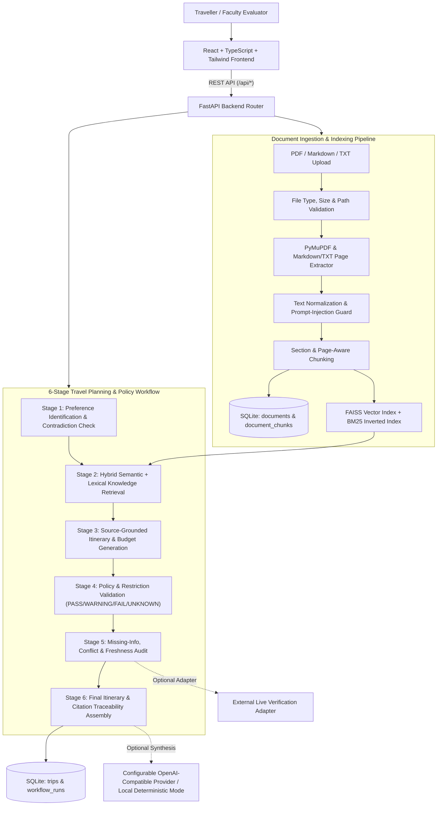

# TripWise AI — System Architecture

## 1. High-Level Overview

TripWise AI is a full-stack, evidence-grounded Travel Planning and Policy Assistant. Rather than relying on an LLM's unconstrained general knowledge, the system ingests a curated local library of travel guides and policy documents (PDF, Markdown, and TXT), indexes them into a hybrid semantic (FAISS) and lexical (BM25) retrieval engine, and runs a 6-stage planning and policy verification pipeline.

## 2. Core Architectural Layers

1. **Presentation Layer (`frontend/`)**:
   - Built with React 18, TypeScript, Vite, Tailwind CSS, Recharts, and Lucide icons.
   - Features the Landing Page, 4-Step Trip Planning Wizard, 7-Tab Main Planning Dashboard, Interactive 6-Stage Workflow Tracker, Clickable Source Evidence Inspector Modal, and Document Library Manager.

2. **API & Service Layer (`backend/app/api/`, `backend/app/services/`)**:
   - FastAPI REST endpoints with strict Pydantic request/response validation.
   - `LLMService` encapsulates optional external LLM calls while guaranteeing 100% functional local deterministic execution when no API key is configured or if an external provider fails.
   - `LiveVerificationAdapter` provides an optional, SSRF-guarded external verification interface that explicitly reports `"unavailable"` or `"failed"` rather than simulating success.

3. **Document Processing & Hybrid Retrieval Layer (`backend/app/retrieval/`)**:
   - `document_processor.py`: Validates uploads, extracts page-numbered text from PDFs via `PyMuPDF` (`pymupdf`) and section-headed pages from `.md`/`.txt`, neutralizes prompt-injection directives, and segments text into metadata-rich chunks.
   - `hybrid_retriever.py`: Combines dense semantic vector search (`faiss.IndexFlatIP` with `SentenceTransformer` / deterministic 384-dim semantic projection) and BM25 lexical keyword scoring (`0.55 * semantic + 0.45 * lexical`), deduplicating chunks and preserving page numbers.

4. **Persistence Layer (`backend/app/db/database.py`)**:
   - SQLite database using parameterized SQL queries (`documents`, `document_chunks`, `trips`, `workflow_runs`).
   - Maintains strict synchronization between SQLite chunk IDs and FAISS vector rows on upload, re-index, and deletion.
