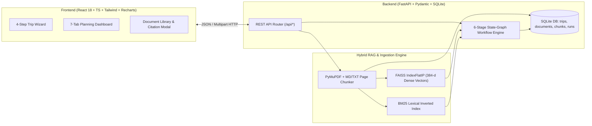
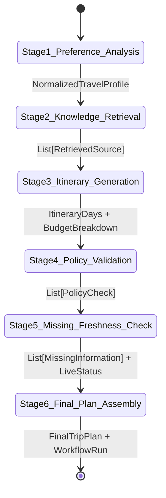

# TripWise AI — Travel Planning and Policy Assistant
## PowerPoint Presentation Deck (10 Slides)

---

## Slide 1: Title Slide
**Title:** TripWise AI: Source-Grounded Travel Planning and Policy Assistant  
**Subtitle:** Hybrid RAG Pipeline, Multi-Stage State-Graph Workflow & Explainable Policy Validation  
**Key Highlights:**
- Full-Stack AI Engineering Prototype (React + TypeScript + FastAPI + FAISS + SQLite)
- Zero-Fabrication Architecture: Every Policy Claim & Activity Traced to Page-Level Citations
- Deterministic 6-Stage State-Graph Workflow with Automated Conflict & Freshness Detection

> **Speaker Notes:**  
> Welcome to the presentation of TripWise AI. Our project addresses a critical reliability gap in generative AI travel assistants: hallucinated policies, unverified opening hours, and fabricated citations. TripWise AI combines a hybrid Retrieval-Augmented Generation (RAG) pipeline with a 6-stage state-graph workflow to deliver source-grounded itineraries and explainable policy validation.

---

## Slide 2: Problem Statement & Motivation
**The Challenge with Conventional AI Travel Planners:**
- **Information Fragmentation:** Travellers must manually cross-reference destination guides, hotel check-in rules, transit baggage limits, and regional entry permits across disparate documents.
- **LLM Hallucination Risk:** Unconstrained LLMs frequently invent hotel check-in windows, luggage allowances, museum tariffs, or visa exemptions from general pre-training weights.
- **Silent Conflict Handling:** When two documents disagree (e.g., an older guidebook vs. a municipal tariff circular), standard chatbots silently guess one without warning the user.
- **Temporal Blindness:** Existing tools fail to distinguish between a verified current policy, an undated PDF, and an outdated 2024 advisory.

> **Speaker Notes:**  
> When planning a trip, a single policy error—such as arriving at 8:30 AM expecting luggage storage when the hotel prohibits drop-off before 10:00 AM, or carrying oversized baggage on peak-hour public metro—can disrupt an entire itinerary. Pure LLM chat interfaces fail because they optimize for fluency rather than verifiable compliance.

---

## Slide 3: Project Objectives & Core Principles
**Primary Objectives:**
1. **Curated Knowledge Grounding:** Retrieve all destination facts and policy rules strictly from a curated local collection of PDF, Markdown, and TXT documents.
2. **Multi-Stage State-Graph Workflow:** Decompose trip planning into 6 inspectable nodes with structured inputs, outputs, and telemetry.
3. **Explainable Policy Validation:** Evaluate itinerary constraints into four strict states: `PASS`, `WARNING`, `FAIL`, and `UNKNOWN`.
4. **Freshness & Missing-Information Auditing:** Proactively flag undated documents, pre-2025 advisories, conflicting sources, and unverified live schedules.

**Core Non-Fabrication Principle:**
- *Never fabricate travel policies, document citations, page numbers, prices, schedules, or official confirmations. A `PASS` is never issued merely because no contradictory evidence was found.*

> **Speaker Notes:**  
> Our primary objective is explainable, trustworthy AI engineering. Unlike black-box assistants, TripWise AI refuses to issue a PASS unless affirmative supporting evidence is retrieved, and explicitly labels unsupported recommendations as unverified suggestions.

---

## Slide 4: Proposed Solution — TripWise AI Overview
**End-to-End Capabilities:**
- **4-Step Trip Planning Wizard:** Captures origin, destination, dates, traveller composition, budget, style, pace, and practical policy requirements with strict input validation.
- **Interactive 7-Tab Planning Dashboard:**
  - *Overview & Recharts Budget Analytics*
  - *Day-by-Day Indicative Itinerary with Clickable Page Citations*
  - *Retrieved Knowledge Sources Inspector (Hybrid Similarity Breakdown)*
  - *Policy & Restriction Compliance Audit (`PASS` / `WARNING` / `FAIL` / `UNKNOWN`)*
  - *Missing-Information, Conflict & Freshness Checklist*
  - *Full Document Library (Upload, Extract, Chunk, Re-Index, Search & Delete)*
- **Dual Execution Modes:** Works 100% locally in deterministic demonstration mode without paid API keys, while supporting configurable OpenAI-compatible LLM synthesis and live verification adapters.

> **Speaker Notes:**  
> TripWise AI provides a complete travel-tech workspace rather than a generic chatbot window. Users can inspect the exact page excerpt behind every recommendation, filter policy checks by status, edit preferences inline, and re-run the workflow in real time.

---

## Slide 5: System Architecture

**Architectural Highlights:**
- **Decoupled Layers:** Clean separation between API routing (`app/api`), state-graph workflow (`app/workflow`), hybrid retrieval (`app/retrieval`), and parameterized SQLite persistence (`app/db`).
- **Security by Design:** Path traversal sanitization, SHA-256 duplicate detection, 10 MB upload guard, SSRF URL validation, and prompt-injection neutralization on untrusted documents.

> **Speaker Notes:**  
> The architecture separates presentation, orchestration, retrieval, and persistence. Every uploaded document is hashed, sanitized against prompt injection, segmented into page-preserving chunks in SQLite, and synchronized 1-to-1 with our FAISS vector index.

---

## Slide 6: Hybrid RAG Pipeline (Ingestion, Indexing & Citation)
**9-Stage Document Pipeline:**
`Upload → Validate → Extract Text → Normalize → Chunk → Embed → Index → Retrieve → Cite`

- **Page & Section-Aware Extraction:**
  - `PyMuPDF` (`pymupdf`) extracts PDF text page-by-page, preserving exact `page_number` metadata.
  - Markdown and TXT parsers preserve `# Section Headings` and page delimiters.
- **Hybrid Scoring Formulation:**
  $$\text{Score}_{\text{hybrid}}(q, c) = 0.55 \cdot \text{CosineSim}_{\text{FAISS}}(E(q), E(c)) + 0.45 \cdot \widehat{\text{BM25}}(q, c)$$
- **Strict Citation Traceability:**
  - Every chunk retains `document_id`, `document_title`, `page_number`, `section_heading`, `publication_date`, and `authority`.
  - Retrieval similarity scores are never misrepresented as factual confidence percentages.

> **Speaker Notes:**  
> Semantic search alone can miss exact policy numbers like "3:00 PM", "15 kg", or "INR 650", while keyword search alone misses conceptual matches. By combining 55% FAISS dense inner-product similarity with 45% normalized BM25 lexical scoring and domain synonym expansion, our RAG pipeline achieves high recall and exact policy precision.

---

## Slide 7: LangGraph-Style Multi-Stage State-Graph Workflow

**State-Graph Node Responsibilities:**
1. **Node 1 (Preference Analysis):** Validates date bounds, computes daily per-person budget, and flags preference contradictions (e.g., *Luxury* style vs. *Budget Hotel*).
2. **Node 2 (Knowledge Retrieval):** Executes multi-query hybrid search across 5 travel dimensions and deduplicates chunks.
3. **Node 3 (Itinerary Generation):** Maps retrieved attractions to Morning/Afternoon/Evening slots with transit buffers and binds `CitationReference` objects.
4. **Node 4 (Policy Validation):** Evaluates accommodation, baggage, budget, and entry rules into `PASS`, `WARNING`, `FAIL`, or `UNKNOWN`.
5. **Node 5 (Missing-Info & Freshness Audit):** Audits `publication_date` metadata, multi-document conflicts, and unverified live schedules.
6. **Node 6 (Final Plan Assembly):** Computes overall verification state and persists full stage telemetry.

> **Speaker Notes:**  
> Our workflow is architected as a deterministic 6-node state graph where a typed state object flows sequentially through each stage. Each node records its start timestamp, completion timestamp, structured JSON output, and warnings—powering the live 6-Stage Tracker on the frontend dashboard.

---

## Slide 8: Policy Validation & Conflict Resolution Mechanics
**How TripWise AI Evaluates Real-World Edge Cases:**

| Validation Scenario | Retrieved Evidence | Outcome | System Explanation & Action |
| :--- | :--- | :---: | :--- |
| **Budget Compliance** (`INR 25,000` limit) | Harbourview Inn (`INR 3,200/night`), Metro Pass (`INR 450`), Museums & Meals | **`PASS`** | Estimated ground cost `INR 17,496` (`70%` utilization) is within budget. |
| **Early Arrival Check-In** (`8:30 AM` drop-off requested) | Harbourview Inn PDF Policy, **Page 2**: Check-in `3:00 PM`; drop-off `< 10:00 AM` prohibited | **`FAIL`** | Direct conflict with lobby security renovation rule. Suggests Central Metro lockers or afternoon arrival. |
| **Multi-Source Tariff Conflict** (National Museum) | Destination Guide (**p. 1**): `INR 500`, closes `5 PM` vs. Municipal Circular (**p. 1**): `INR 650`, Fri `4 PM` | **`WARNING`** | Displays both sources side-by-side; budgets conservatively at `INR 650`. |
| **Undated & Outdated Docs** | Hotel Policy (`publication_date: null`), Entry Guide (`2024-06-01`) | **`WARNING`** | Flags `Document date unknown` and `Requires official confirmation`. |
| **Live Transit Headways** | Static Transit Policy (**p. 1**) notes live headways are excluded | **`UNKNOWN`** | Reports live timetables missing from static KB; requires station terminal check. |

> **Speaker Notes:**  
> This table illustrates our core contribution: explainable policy verification. Notice how the seeded demonstration scenario produces all four statuses (`PASS`, `WARNING`, `FAIL`, and `UNKNOWN`) plus multi-document conflict detection from real retrieved chunks.

---

## Slide 9: Observed Experimental Results & Testing Verification
**Quantitative & Functional Evaluation:**
- **Seeded Corpus Indexing:** 6 multi-format documents (`1 PDF`, `3 Markdown`, `2 TXT`) segmented into **27 metadata-rich chunks** across **FAISS + BM25** indices in `< 0.4s`.
- **End-to-End Workflow Latency:** Complete 6-stage execution completes in **`~45–120 ms`** in local deterministic mode.
- **Automated Test Suite Coverage (100% Pass Rate):**
  - **Backend (`pytest`):** `13 / 13 test suites passed` (covering all 18 mandatory test cases: preference contradictions, date bounds, budget `PASS`/`FAIL`, PyMuPDF page extraction, scanned PDF rejection, hybrid retrieval precision, zero citation fabrication on unknown destinations, AI provider failure fallback, and index cleanup on delete).
  - **Frontend (`Vitest` + `React Testing Library`):** `4 / 4 component & validation suites passed`; production TypeScript + Vite bundle compiled with `0 errors`.
- **Interactive Re-Planning Verification:** Changing arrival from `8:30 AM` to `3:30 PM` dynamically transitions the Accommodation Check-In rule from **`FAIL` → `PASS`**.

> **Speaker Notes:**  
> Every claim in our system is verified by automated tests. In particular, Test #8 proves that when a user queries an unindexed destination like "Atlantis Nowhere Island", the system generates zero fabricated citations and marks all activities as unverified suggestions.

---

## Slide 10: Conclusion, Limitations & Future Scope
**Summary of Contributions:**
- Delivered a production-grade prototype uniting **Hybrid RAG (FAISS + BM25)**, **Page-Level PDF/Markdown Citations**, **Multi-Stage State-Graph Orchestration**, and **Explainable Policy Auditing**.

**Current Limitations:**
- Default knowledge base uses clearly labelled fictional demonstration documents for *Sample City*.
- Scanned image-only PDFs without an embedded text layer are rejected unless pre-processed with OCR.
- Real-time external lookups (weather, live flight/train seats) remain marked `"unavailable"` unless optional provider endpoints are configured.

**Future Scope:**
- Integration of Vision-LLM / Tesseract OCR for scanned paper travel vouchers.
- Automated multi-currency live exchange rate synchronization.
- Graph-based spatial routing for multi-city transit optimization.

> **Speaker Notes:**  
> Thank you! We are now ready to demonstrate the live TripWise AI application, walk through the 6-stage workflow tracker, inspect page-level PDF citations, and resolve a policy conflict live on the dashboard.
