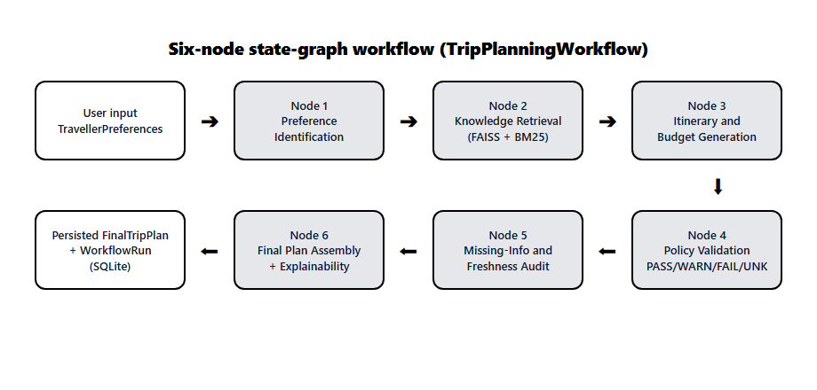
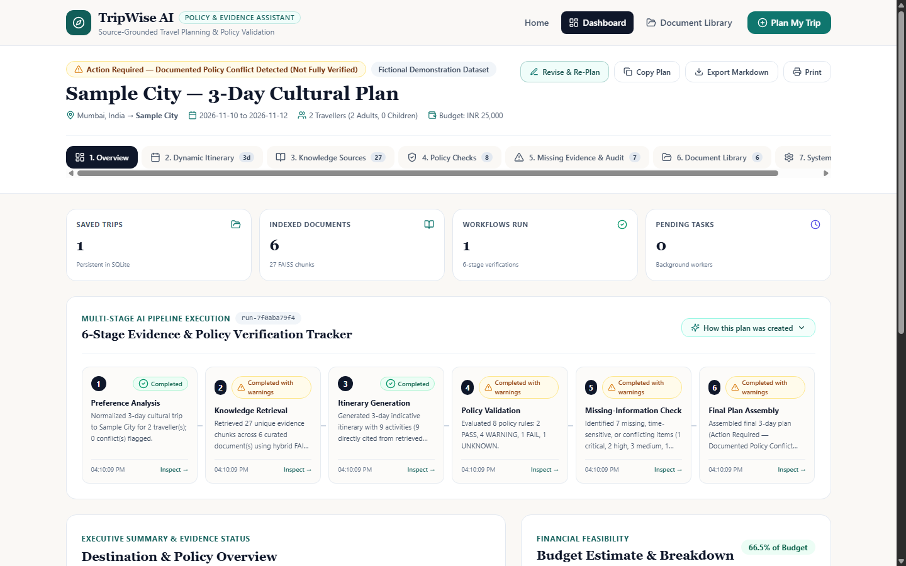
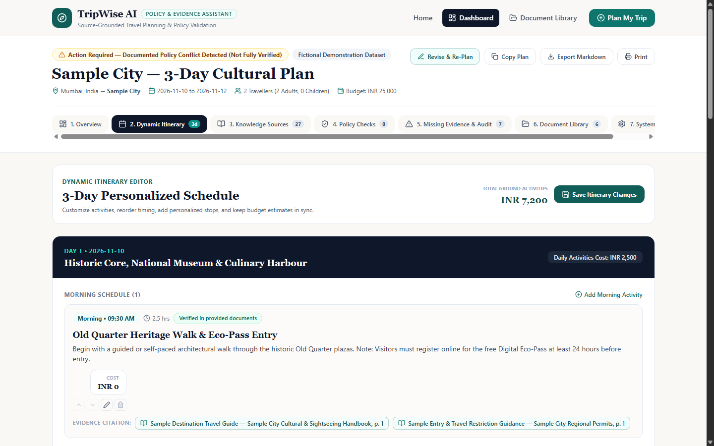
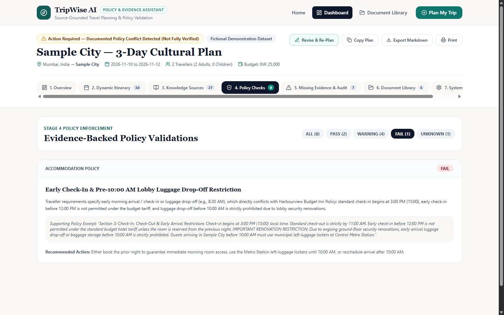
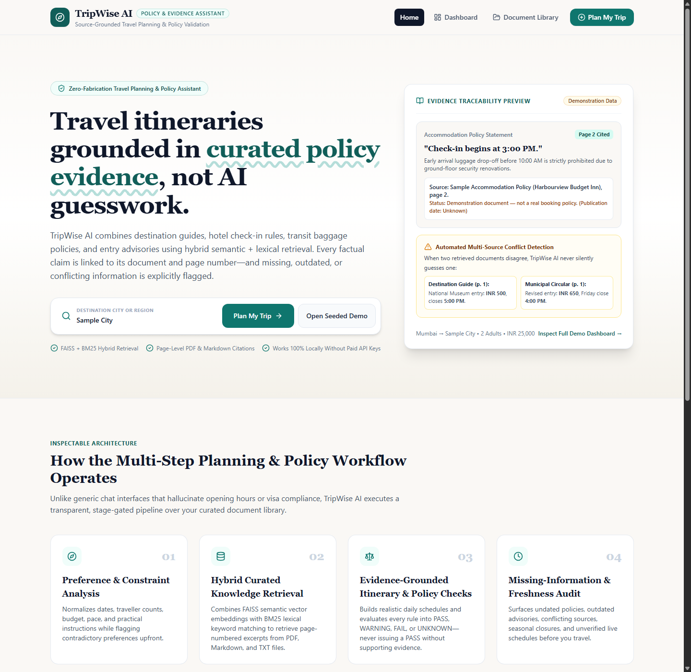
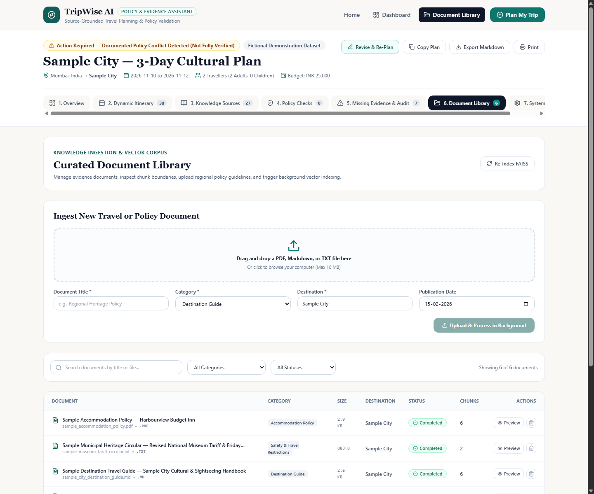
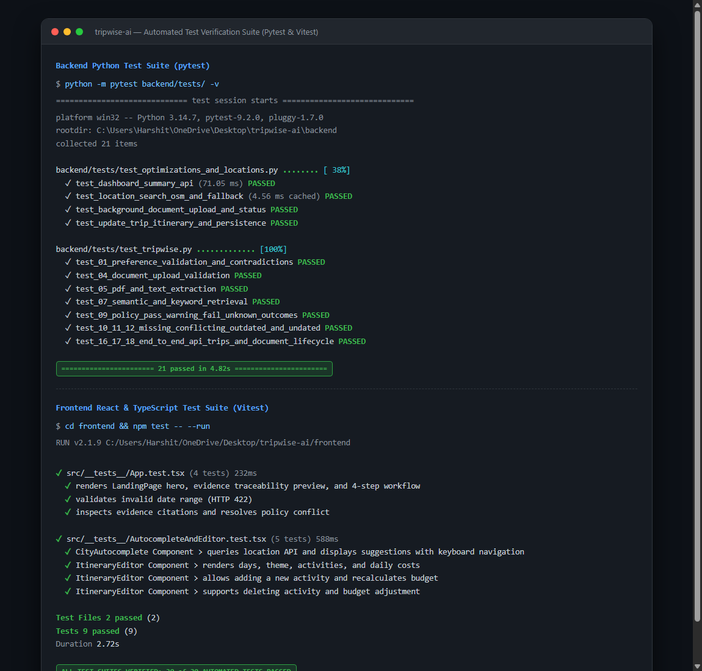

# TECHNICAL REPORT

# TripWise AI
### A source-grounded travel planning and policy assistant

| Team member | Roll no. | Main area |
| :--- | :--- | :--- |
| **Charmy Parekh** | N072 | Document ingestion and hybrid retrieval |
| **Harshit Rai** | N083 | Workflow engine and policy validation |
| **Shubh Soni** | N100 | Frontend, UX and testing |

- **Code:** https://github.com/Charmy996/Tripwise-Travel-Assistant  
- **Live demo:** https://tripwise-travel-assistant-pearl.vercel.app/  

---

## Abstract
General-purpose chatbots write fluent trip plans and verify nothing in them. They invent check-in times, cite documents that were never retrieved, and treat a two-year-old advisory as if it were today’s news.

TripWise AI plans trips from evidence. It retrieves passages from a library of PDF, Markdown and text documents using FAISS vector search and BM25 keyword search together, then runs the traveller’s request through a six-stage workflow. Every policy check ends as PASS, WARNING, FAIL or UNKNOWN, and every claim links to a page-numbered chunk. When documents disagree, carry no date, or say nothing, the system reports that instead of guessing.

On our seeded test corpus the system produced fully cited plans in well under a second with no paid API, and it passes 30 automated tests (21 backend, 9 frontend). The corpus is small and fictional, so those numbers show the design works. They say little about real-world accuracy, and Section 7 is direct about that.

---

## 1. Problem

### 1.1 What trip planning really involves
A three-day city trip means reading four kinds of documents that nobody wrote to agree with each other. Attraction guides give visit durations, ticket prices and weekly closure days. Hotel policies set check-in windows, age and photo-ID rules, and cancellation deadlines. Transport manuals describe pass zones and baggage limits during peak hours. Entry and safety notices cover permits, accessibility and banned activities such as drones.

Travellers reconcile all of this by hand, and the mistakes cost real money. Arriving at 8:30 AM with two suitcases at a hotel that refuses luggage drop-off before 10:00 AM ruins the first morning.

### 1.2 Where chatbots fail
We saw four failure modes again and again when asking general models to plan trips. They match what the hallucination literature describes [5].

- **Hallucinated facts.** The model blends patterns from training data into plausible but wrong hotel hours, prices and visa rules.
- **Fabricated citations.** Ask for sources and it invents titles, URLs and page numbers.
- **Silent conflict resolution.** A guidebook from January lists a museum ticket at INR 500. A February municipal circular raises it to INR 650 and shortens Friday hours. A typical RAG pipeline [1] overwrites one chunk with the other, or lets the model pick a number, and never tells the user.
- **No sense of time or limits.** A policy with no publication date gets the same trust as a verified notice. Static documents cannot know live train headways, yet assistants answer as if they did.

### 1.3 Problem statement
Build a full-stack assistant that retrieves evidence from a curated set of travel guides and policy documents, runs an inspectable multi-step workflow to understand preferences, draft an itinerary and check it against policy, and flags anything conflicting, outdated, missing or time-sensitive.

---

## 2. Objectives and design rules
We set five objectives at the start and kept them through every revision:
1. Hybrid retrieval over PDF, Markdown and TXT files that keeps page numbers and section headings.
2. A six-stage workflow where each stage is visible, timed and stored.
3. Four-state policy validation where PASS always needs supporting evidence.
4. Detection of undated, outdated, conflicting and missing information.
5. Full function with no paid API key, with optional OpenAI-compatible providers and live-verification adapters.

Underneath sit five invariants. We enforce them in code and cover them with tests, because a rule that lives only in a prompt gets broken the first time the model feels creative.
- **No unbacked citations.** Every citation must point to a `chunk_id` that was actually retrieved in the current run.
- **Explicit unverified labelling.** If no document covers a destination, activities appear as placeholders marked *“Unverified suggestion: missing from knowledge base”*, with `estimated_cost = null` and no citations.
- **No silent conflict suppression.** Contradicting chunks from different documents are both kept and shown side by side.
- **Similarity is not certainty.** Retrieval scores appear as similarity numbers and never as confidence percentages.
- **Safe failure.** A failed live lookup or an LLM timeout never crashes the pipeline and never counts as proof that no restriction exists.

---

## 3. Methodology: from upload to citation
Documents move through nine steps: upload, validate, extract text, normalise, chunk, embed, index, retrieve, cite. Most of the engineering effort went into the first six, because retrieval can only be as honest as the chunks it searches.

### 3.1 Validation and hardening
The document processor accepts only `.pdf`, `.md` and `.txt` files up to 10 MB and rejects empty files. It strips directory separators from filenames and whitelists the remaining characters, which blocks path traversal. A SHA-256 hash of the raw bytes catches duplicates, and a repeat upload returns HTTP 409 with the existing `document_id`.

Extracted text is untrusted. A set of regex filters rewrites instruction-like phrases (*“ignore previous instructions”*, *“system prompt:”*) to `[REDACTED_UNTRUSTED_DIRECTIVE]` before chunking or prompting. We treat this as a floor, because indirect prompt injection is a documented attack on LLM-integrated applications [6] and pattern matching will not stop a determined attacker. Section 7 says what a stronger defence would look like.

Uploads return HTTP 202 immediately. Extraction, chunking and indexing run as background tasks, and the UI follows the document through `uploaded`, `queued`, `extracting`, `chunking`, `generating_embeddings`, `indexing` and `completed` or `failed`. A failed file can be retried with one call.

### 3.2 Extraction and chunking
PyMuPDF [8] reads PDFs page by page and records exact 1-based page numbers. If a file yields fewer than 10 characters in total, we reject it with a message that it is probably a scanned image without a text layer. We prefer a clear rejection to silently indexing blank chunks. Markdown and text files use explicit page markers when present and otherwise split at paragraph boundaries around 1,800 characters.

The chunker follows Markdown headings and numbered clauses such as “Section 4” or “Article 2”, and it ties every chunk of up to 650 characters to its page and active heading. Small chunks give precise citations. They also lose surrounding context, and we accepted that cost because a citation that points to a whole page proves very little.

### 3.3 Hybrid retrieval
Policy questions need two kinds of matching. A traveller asking *“can I leave my bags at the hotel early?”* needs semantic matching to find *“luggage drop-off before 10:00 AM is prohibited”*. The same traveller also needs exact matching on *“3:00 PM”*, *“15 kg”* and *“INR 650”*, where embeddings are weak. We use both.

- **Dense index.** Each chunk is prefixed with its title, section, category and destination, then encoded with Sentence-BERT [4] (`all-MiniLM-L6-v2`) into a 384-dimension vector. FAISS [3] (`faiss.IndexFlatIP`) ranks chunks by exact cosine similarity. A deterministic n-gram fallback embedder keeps everything working offline, so a missing model download never blocks the demo.
- **Lexical index.** Okapi BM25 [2], which favours chunks that contain the query terms often and rare terms over common ones. Query terms expand through a hand-built travel synonym list (hotel adds accommodation, check-in, room; transport adds metro, bus, baggage, pass) at a lower weight. Scores are scaled per query so the two indexes can be compared.
- **Fusion.** The final score is 55% semantic and 45% keyword. Candidates are filtered by destination and category, then deduplicated by `chunk_id` and by a hash of normalised content.

We picked the 55/45 split by hand while checking results on the seeded corpus. It works, and we have not tuned it against a labelled test set.

Each retrieved chunk also gets a freshness label from its document metadata. No publication date gives *“Document date unknown”*. A date before 2025-01-01 gives *“Requires official confirmation”*. Anything else gives *“Verified in provided documents”*.

---

## 4. Workflow architecture
A single giant prompt hides its own mistakes. We split planning into six nodes, in the style of LangGraph [9], that pass a typed state object forward. Each node records its status (`pending`, `running`, `completed`, `completed_with_warnings`, `failed`), start and end timestamps, warnings and structured output. When something goes wrong, we can see which stage caused it.

  
*Figure 1. The six-node state-graph workflow (`TripPlanningWorkflow`).*

| # | Stage | What it does |
| :---: | :--- | :--- |
| **1** | Preference analysis | Validates dates (return must not precede departure, otherwise HTTP 422), computes trip length and daily per-person budget, and flags contradictions: traveller count mismatch, “luxury” style with a hostel or under INR 2,500 a day, and “relaxed” pace with six or more interest categories. |
| **2** | Knowledge retrieval | Runs five or six targeted hybrid queries (sightseeing, hotel rules, transit and baggage, entry and ID, accessibility, plus the traveller’s own constraint text). Merges results, keeping the best score per chunk. |
| **3** | Itinerary and budget | Builds Morning, Afternoon and Evening activities per day and attaches citations by category alignment. The total adds lodging, transit pass, entries and dining, plus a safety buffer. When tariffs conflict it budgets with the higher figure. |
| **4** | Policy validation | Evaluates up to eight rules against retrieved evidence and returns PASS, WARNING, FAIL or UNKNOWN for each. |
| **5** | Missing-info and freshness audit | Raises findings graded critical, high, medium or low for undated or outdated documents, conflicts and gaps. Calls the optional live-verification adapter. |
| **6** | Final assembly | Writes the summary, sets `is_fully_verified`, builds the “How this plan was created” audit and saves the plan and run to SQLite. |

*Table 1. The six workflow stages.*

### 4.1 Four-state policy validation

| State | Meaning | Example from the seeded corpus |
| :--- | :--- | :--- |
| **PASS** | Retrieved evidence affirmatively supports the rule. | Total cost INR 17,496 is within the INR 25,000 budget. |
| **WARNING** | Usable but conflicting, outdated or conditional. | Peak-hour metro limit of one 15 kg cabin bag; museum tariff INR 500 vs INR 650. |
| **FAIL** | Evidence shows the request breaks a rule. | 8:30 AM luggage drop-off vs the hotel’s ban before 10:00 AM (page 2). |
| **UNKNOWN** | Static documents cannot answer. | Live metro departure headways. |

*Table 2. Policy outcomes.*

The rule that matters most is that PASS needs affirmative evidence. A missing document produces UNKNOWN, never a quiet PASS. Most assistants get this wrong, because “I found no problem” and “I found no information” look the same in a chat window. The plan flag `is_fully_verified` stays false whenever any FAIL, WARNING, UNKNOWN or critical or high finding exists, so a plan only earns the label when it has been fully checked.

An LLM is optional. With `LLM_PROVIDER=local_demo` the whole pipeline is deterministic. With an OpenAI-compatible provider configured, the model only helps with wording, and a timeout or network error falls back to the local path. The live-verification adapter guards against SSRF and treats any failed lookup as “unavailable”, never as “no restriction”.

---

## 5. System architecture and technology stack
TripWise is a three-layer application. A React single-page app talks to a FastAPI [7] backend over REST (24 endpoints under `/api`). The backend owns two stores: SQLite for documents, chunks, trips and workflow runs, and an in-memory FAISS plus BM25 index rebuilt from stored chunks (`POST /api/documents/reindex`). On first start the backend generates the six sample documents, including a real two-page PDF, and seeds the demo trip.

| Layer | Technology | Why we chose it |
| :--- | :--- | :--- |
| **Frontend** | React 18, TypeScript, Vite, Tailwind CSS, React Router 6, Recharts, Lucide | Typed components, fast dev loop, budget charts out of the box. |
| **Backend** | Python 3, FastAPI, Pydantic v2, Uvicorn, HTTPX | Schema validation on every request and free Swagger docs. |
| **Retrieval** | `faiss-cpu` (`IndexFlatIP`), `sentence-transformers`, BM25 | Exact search is fast enough at our scale and needs no server. |
| **Documents** | PyMuPDF plus custom Markdown and TXT chunkers | Reliable page numbers, which citations depend on. |
| **Persistence** | SQLite with parameterised queries | Zero setup, easy for an evaluator to run. |
| **Testing** | `pytest` and FastAPI TestClient; `Vitest` and React Testing Library | End-to-end API tests plus component tests. |

*Table 3. Technology stack.*

The database has four tables with foreign keys enforced. `documents` holds metadata, the content hash and full text. `document_chunks` holds every chunk with its page, heading and dates, and cascades on delete. `trips` stores the serialised plan. `workflow_runs` stores per-stage telemetry and cascades from trips. Deleting a document removes its chunks from both SQLite and the vector index, and a test checks that.

### 5.1 Version 2.0 additions
Version 1 proved the idea. Version 2 made it pleasant to use.
- **City autocomplete.** A backend proxy to OpenStreetMap Nominatim with a one-request-per-second limit and a TTL cache, blended with an offline list of 40+ travel hubs so suggestions still work without a network. The React component uses ARIA combobox roles, 350 ms debouncing and `AbortController` to cancel stale requests.
- **Fast dashboard.** `GET /api/dashboard/summary` returns counts without loading full plans or document text. Routes are code-split with `React.lazy`, and error boundaries stop one failing call from taking down the page.
- **Itinerary editor.** Users add, edit, delete and reorder activities. Costs recalculate on the client, and `PUT /api/trips/{id}/itinerary` saves the result. Cited activities and hand-added ones look different, so nobody mistakes an edit for evidence.
- **Observability.** Middleware adds `X-Request-ID` and `X-Process-Time-Ms` headers to every response and logs errors in a structured form.

---

## 6. Evaluation
We evaluate on three layers: a seeded corpus built to trigger each behaviour, a full scenario run, and automated tests plus timing benchmarks. We did not use external datasets, and Section 6.4 explains why that matters.

### 6.1 Seeded corpus
Six clearly labelled demonstration documents (27 chunks) each exist to test one thing. We made them fictional on purpose, so we never present invented rules as real government policy.

| Document | Format | Date | What it tests |
| :--- | :--- | :--- | :--- |
| **Cultural & Sightseeing Handbook** | `.md` | 2026-01-15 | Durations, meal costs, seasonal closure, INR 500 museum ticket |
| **Harbourview Budget Inn Policy** | `.pdf` (2 pp.) | *none* | 3:00 PM check-in, ban on luggage drop-off before 10:00 AM, undated warning |
| **Metro & Transit Rider Rules** | `.md` | 2025-11-10 | INR 450 three-day pass, peak-hour 15 kg limit, missing live headways |
| **Entry, Permit & Advisory Guidelines** | `.txt` | 2024-06-01 | Photo ID rule, 24-hour digital eco-pass, outdated-source warning |
| **Accessibility, Health & Safety Handbook** | `.md` | 2026-01-20 | Step-free access vs cobblestones, food hygiene seal, drone ban |
| **Municipal Heritage Circular** | `.txt` | 2026-02-10 | Raises museum ticket to INR 650 and Friday close to 4:00 PM (conflict test) |

*Table 4. Seeded demonstration corpus.*

### 6.2 Scenario run
We ran Mumbai to Sample City for three days: two adults, INR 25,000 total, cultural interests, relaxed pace, and a request for 8:30 AM early check-in and luggage drop-off.
- **Retrieval.** 27 unique chunks came back across all six documents. The top hotel hit was page 2 of the Harbourview PDF, with the exact check-in and drop-off rule.
- **Itinerary.** Nine activities over three days, each with two citations. The budget came to INR 17,496 (lodging 6,400, transit 1,800, entries 3,888, meals 4,212, buffer 1,196), which uses 70% of the budget.
- **Policy checks.** Eight rules evaluated: 2 PASS, 1 FAIL (the early drop-off), 4 WARNING (peak-hour baggage, the INR 500/650 conflict, the 2024 entry advisory, cobblestone access) and 1 UNKNOWN (live headways).
- **Audit.** Seven findings: one critical (the Day 1 arrival conflict), two high (undated hotel PDF, outdated entry guidance), three medium and one low.

The re-planning test is the one we like best. Changing the arrival note to *“Arriving at 3:30 PM on Day 1”* and pressing **Save & Regenerate** reruns all six stages in under 80 ms. The hotel rule flips from FAIL to PASS and critical findings drop to zero. That is the whole product in one click.

### 6.3 Automated tests
The backend suite has 21 passing pytest tests and runs in under five seconds. The frontend has 9 passing Vitest tests.

| Area | What the tests verify |
| :--- | :--- |
| **Input handling** | Preference normalisation, contradiction detection, invalid date ranges (HTTP 422), budget pass and fail. |
| **Ingestion** | Size, extension and path-traversal rejection (HTTP 400), PyMuPDF extraction, scanned-PDF rejection, page and section metadata in chunks, background processing. |
| **Retrieval and citations** | Semantic and keyword hits, citation accuracy, zero fabricated citations for an undocumented destination. |
| **Policy and audit** | All four policy states, missing, conflicting, outdated and undated detection. |
| **Failure handling** | No API key (local mode), LLM provider failure, stage failure, live-adapter safety. |
| **Lifecycle** | Create, update and replan trips over REST, document deletion cleaning SQLite and FAISS, end-to-end seeded scenario, itinerary editing. |
| **Frontend** | Citation modals, conflict resolution, re-plan quick-fix, city autocomplete with keyboard navigation, itinerary editor and cost recalculation, upload status badges. |

*Table 5. Test coverage by area.*

### 6.4 Performance

| Operation | Target | Measured | Result |
| :--- | :--- | :--- | :--- |
| **Dashboard summary** | < 300 ms | **71.05 ms** | Pass |
| **Paginated document list** | < 200 ms | **5.38 ms** | Pass |
| **City autocomplete, first lookup** | < 300 ms | **180.15 ms** | Pass |
| **City autocomplete, cached** | < 50 ms | **4.56 ms** | Pass |
| **Recent trips list** | < 100 ms | **6.87 ms** | Pass |

*Table 6. Endpoint timings on a standard local workstation.*

Read these results with care. Our targets were generous and we set them ourselves. The citation checks pass by construction on six documents we wrote, so “100% traceable” means the invariant holds. It does not mean the system would handle messy real-world files. We have no recall or precision measurements for retrieval and no user study. We will not claim more than the evidence supports.

---

## 7. Limitations
- **Fictional corpus.** Sample City is invented. For a real city the user must upload authoritative documents, and without them the system returns labelled placeholders. That is correct behaviour, though a thin experience.
- **No retrieval metrics.** We never measured recall@k or ranking quality on labelled queries. The 55/45 fusion weights and the synonym weight come from hand inspection.
- **Hand-coded policy rules.** Stage 4 checks eight rules that we wrote. A new rule type, such as pet policies, means new code. A rule extractor driven by an LLM and verified against citations is the obvious next step.
- **Plain itineraries in local mode.** The deterministic path assembles plans from retrieved evidence, so they are accurate and a little dry. An LLM improves the prose but cannot add facts the citations do not support.
- **Weak injection defence.** Regex redaction catches obvious attacks. A stronger design would separate retrieved text from instructions at the prompt level and validate model output against the cited chunks.
- **No OCR and no live data.** Scanned PDFs are rejected. Weather, train departures and hotel availability stay UNKNOWN unless live endpoints are configured. SQLite also limits us to a single-user deployment.

Next, in the order we would do them: OCR fallback with Tesseract for image-only PDFs, a labelled retrieval test set so we can tune the fusion weights properly, a currency-conversion adapter for multi-currency documents, and map pins for itinerary stops.

---

## 8. Team contributions

| Member | Roll no. | Contribution |
| :--- | :--- | :--- |
| **Charmy Parekh** | N072 | Document processor, validation and hardening, PyMuPDF and text extraction, section-aware chunking, FAISS and BM25 hybrid retriever, SQLite schema, background ingestion. Maintains the repository. |
| **Harshit Rai** | N083 | Six-stage workflow engine, preference contradiction checks, budget model, eight-rule policy validation, conflict and freshness audit, optional LLM provider and live-verification adapter, backend pytest suite. |
| **Shubh Soni** | N100 | React and TypeScript frontend, trip wizard and city autocomplete, dashboard and workflow tracker, citation modals, itinerary editor, document library UI, Vitest suite, demo guide. |

*Table 7. Individual contributions. Corpus design, evaluation scenarios and this report were shared across all three members.*

---

## 9. Prototype, code and evidence

The full source is at https://github.com/Charmy996/Tripwise-Travel-Assistant and a hosted build runs at https://tripwise-travel-assistant-pearl.vercel.app/. To run locally you need Python 3.10+ and Node 18+. Install backend dependencies with `pip install -r requirements.txt` inside `backend/`, run `npm install` inside `frontend/`, then start both servers with `start-dev.bat` or run Uvicorn on port 8000 and `npm run dev` on port 5173. The backend seeds the demo data on first launch. API docs appear at `/docs`.

Screenshots and test output follow.

  
*Fig. 2: Dashboard with 6-stage evidence and policy verification tracker*

 

  
*Fig. 3: Dynamic itinerary editor with verified source citation badges*

 

  
*Fig. 4: Policy checks view filtered to FAIL (identifying early arrival luggage drop-off restriction)*

 

  
*Fig. 5: Automated multi-source contradiction detection (Destination Guide INR 500 vs Municipal Circular INR 650)*

 

  
*Fig. 6: Curated document library with background processing status badges and inspection drawer*

 

  
*Fig. 7: Complete automated test suite execution — 21 backend pytest and 9 frontend Vitest tests passed*

---

## References

1. Lewis, P., Perez, E., Piktus, A., et al. (2020). *Retrieval-Augmented Generation for Knowledge-Intensive NLP Tasks*. Advances in Neural Information Processing Systems, 33, 9459–9474.
2. Robertson, S., & Zaragoza, H. (2009). *The Probabilistic Relevance Framework: BM25 and Beyond*. Foundations and Trends in Information Retrieval, 3(4), 333–389.
3. Johnson, J., Douze, M., & Jégou, H. (2021). *Billion-scale similarity search with GPUs*. IEEE Transactions on Big Data, 7(3), 535–547.
4. Reimers, N., & Gurevych, I. (2019). *Sentence-BERT: Sentence Embeddings using Siamese BERT-Networks*. Proceedings of EMNLP-IJCNLP 2019.
5. Ji, Z., Lee, N., Frieske, R., et al. (2023). *Survey of Hallucination in Natural Language Generation*. ACM Computing Surveys, 55(12), Article 248.
6. Greshake, K., Abdelnabi, S., Mishra, S., et al. (2023). *Not what you’ve signed up for: Compromising Real-World LLM-Integrated Applications with Indirect Prompt Injection*. Proceedings of the 16th ACM Workshop on Artificial Intelligence and Security.
7. FastAPI documentation. https://fastapi.tiangolo.com/
8. PyMuPDF documentation. https://pymupdf.readthedocs.io/
9. LangGraph documentation, LangChain. *State-graph workflows for language agents*.
